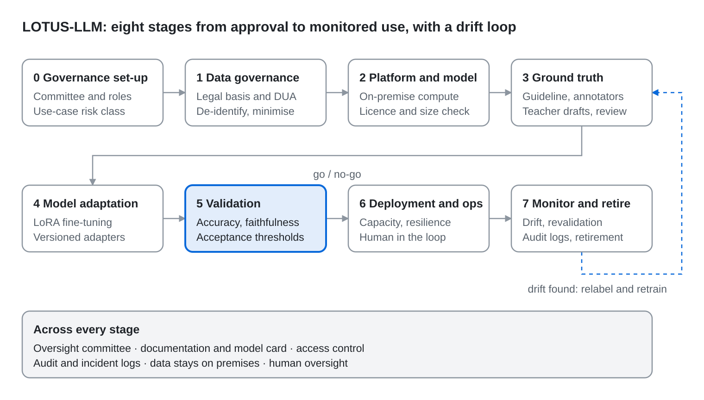

# LOTUS-LLM: Lifecycle for On-premise Tuning Under Safeguards

Code accompanying the manuscript **"LOTUS-LLM: A Governance and Implementation Framework for On-Premise Fine-Tuning of Clinical Language Models in Healthcare Organisations"** (in preparation for *Health Information Science and Systems*; journal and DOI to be added).

LOTUS-LLM shows how a healthcare provider can adapt an open-weight large language model (LLM) to its own clinical notes **without any patient data leaving its premises**. A large local "teacher" model annotates notes, a small local "student" model is fine-tuned with LoRA, and every step is governed, checkpointed and auditable. The case study extracts structured clinical information from MIMIC-III ICU notes on a single NVIDIA DGX Spark.

> **No MIMIC-III data, labels, model outputs or trained adapters are included.** Credentialed PhysioNet access is required to reproduce the case study. See [DATA_USE.md](DATA_USE.md).

## Framework overview



| Stage | Purpose |
| --- | --- |
| 0 Governance set-up | Oversight committee, roles, use case and risk class |
| 1 Data governance | Legal basis (e.g. India's DPDP Act), data-use agreements, de-identification, no transfer off premises |
| 2 Platform and model | On-premise compute sizing; open-weight model chosen by licence, size, language and security |
| 3 Ground truth | Annotation guideline, trained annotators, teacher pre-annotation, double annotation |
| 4 Model adaptation | LoRA fine-tuning, versioned adapters, checkpoints, reproducibility record |
| 5 Validation and assurance | Accuracy, faithfulness to the source note, output validity, acceptance thresholds (go / no-go) |
| 6 Deployment and operations | Capacity and resilience planning, human review, incident handling |
| 7 Monitoring and retirement | Drift monitoring, revalidation, audit trail, retirement |

## Case study

Extraction of **problems, medications, tests and results**, each with **negation, certainty and temporality**, from MIMIC-III discharge summaries, physician and nursing notes into a fixed JSON schema.

| Role | Model |
| --- | --- |
| Teacher, served locally with vLLM | `nvidia/Qwen3.6-35B-A3B-NVFP4` |
| Student, LoRA fine-tuned | `Qwen/Qwen2.5-3B-Instruct` (check its licence for your use) |
| Baselines | Rule-based lexicon with NegEx-style cues; untuned student |

## Component map

| Component | Notebook steps | Script stage (`src/mimic_pipeline.py`) | Framework stage |
| --- | --- | --- | --- |
| Note selection, cleaning, de-duplication, chunking, patient-level split, sampling | 1–4 | `prep` | 1 |
| Schema, guideline, teacher extraction with evidence check | 5–11 | `silver` | 3 |
| Annotator files, label loading, training data | 12–15 | `labels` | 3 |
| LoRA fine-tuning (v1: 4,096 tokens; v2: 8,192 tokens) | 16–18 | `train` | 4 |
| Test-set predictions for all systems | 19–22 | `predict` | 5 |
| Evaluation: teacher agreement, faithfulness, output validity, significance, errors | 23–31 | `eval` | 5 |
| Excel annotation workflow | `src/annot_excel.py` | | 3 |
| Diagnostics (counts only) | `src/diag.py` | | 5, 6 |

Main results come from the `silver`, `train`, `predict` and `eval` stages. The notebook's cells are marked **RUN / SKIP / DO NOT RUN** so it can be restarted after an interruption without redoing heavy steps.

## Repository contents

| Path | What it is |
| --- | --- |
| `notebooks/MIMIC_LoRA_Clinical_IE_Pipeline.ipynb` | Step-by-step notebook, outputs cleared |
| `src/mimic_pipeline.py` | Resumable command-line pipeline |
| `src/annot_excel.py` | Annotation files to Excel workbooks for clinicians and back, with validation |
| `src/diag.py` | Diagnostics that print counts and structure, never note text |
| `scripts/run_pipeline.sh` | Starts or resumes the pipeline in the background |
| `docs/annotation_guideline.md` | Guideline for clinical annotators |
| `figures/Fig1_framework_architecture.svg` | The LOTUS-LLM lifecycle |

## Data access

1. Complete the required training and become a credentialed PhysioNet user.
2. Sign the MIMIC-III v1.4 data use agreement and download the data.
3. Load the MIMIC-III tables into a local DuckDB file (default `~/mimic_project/mimic3.duckdb`, or set `MIMIC_DB`).
4. Optional gold-standard evaluation: request the n2c2 2010 and 2018 Track 2 corpora through the DBMI Data Portal under its own agreement.

**Data use warning:** everything written to the output folder (`IE_OUT_DIR`, default `~/mimic_project/ie_pipeline`) contains note text or text derived from it: teacher and student outputs, labels, annotation workbooks, error analyses. Never commit it to a public repository; share it only with credentialed users. All LLM inference runs on local servers; no patient data is sent to external services.

## Requirements

- Python 3.12; packages in `requirements.txt`.
- A local vLLM server with the teacher model, needed only for teacher annotation and the teacher baseline. Version used: [add your vLLM version].
- Hardware used: one NVIDIA DGX Spark (GB10, 128 GB unified CPU–GPU memory).
- Settings: `MIMIC_DB`, `IE_OUT_DIR`, `VLLM_URL` (environment variables), plus the configuration cell at the top of the notebook.

## Running

```bash
pip install -r requirements.txt
python src/mimic_pipeline.py --status              # what is already done
bash scripts/run_pipeline.sh                        # all stages incl. LoRA training, resumable
PIPELINE_ARGS="--train --tag v2 --max-length 8192 --gen-tokens 8192 --batch-size 1" bash scripts/run_pipeline.sh
python src/mimic_pipeline.py --stage eval          # evaluation only, minutes
```

Approximate run times on one DGX Spark: teacher annotation of 600 chunks about 2.5 h (6–16 parallel requests); LoRA training about 70–110 min; student inference on 120 test chunks about 2–3 h.

## Reproducibility notes

- Fixed seed 42 for the patient-level split, sampling and training.
- Teacher: temperature 0, schema-constrained JSON output, thinking mode off; entities whose evidence is not found in the note are discarded.
- The 600-chunk sample (420 train / 60 validation / 120 test) is saved once and never overwritten, so all systems are scored on the same chunks.
- LoRA: rank 16, alpha 32, dropout 0.05, all attention and MLP projections, 3 epochs, effective batch 16, learning rate 2e-4 (cosine).
- Every output is appended per chunk to JSONL files and flushed to disk; LoRA checkpoints are saved every 10 steps with an integrity check, so all stages resume after interruptions.
- Software versions are written to `results/reproducibility.json` at each evaluation.

## Citation

Please cite the article (BibTeX to be added after publication). Also cite MIMIC-III (Johnson et al., *Sci Data* 2016) and, where used, the n2c2 2010 (Uzuner et al., *JAMIA* 2011) and 2018 (Henry et al., *JAMIA* 2020) shared tasks.

## Licence

MIT, covering the code only (see [LICENSE](LICENSE)). MIMIC-III remains governed by the PhysioNet Credentialed Health Data License and its data use agreement; models are subject to their own licences.

This is a research prototype and must not be used for clinical decision-making.

## Contact

Aditya Saxena, School of Digital Health, IIHMR University, Jaipur, India.
